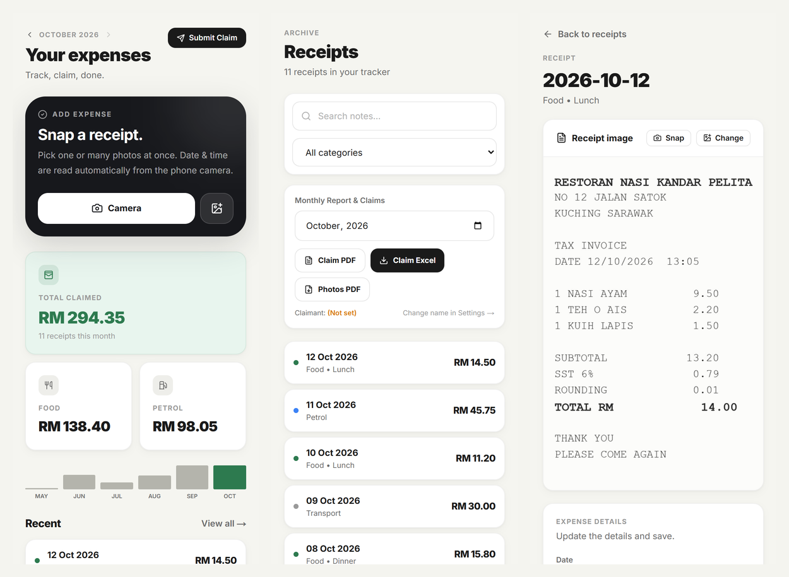
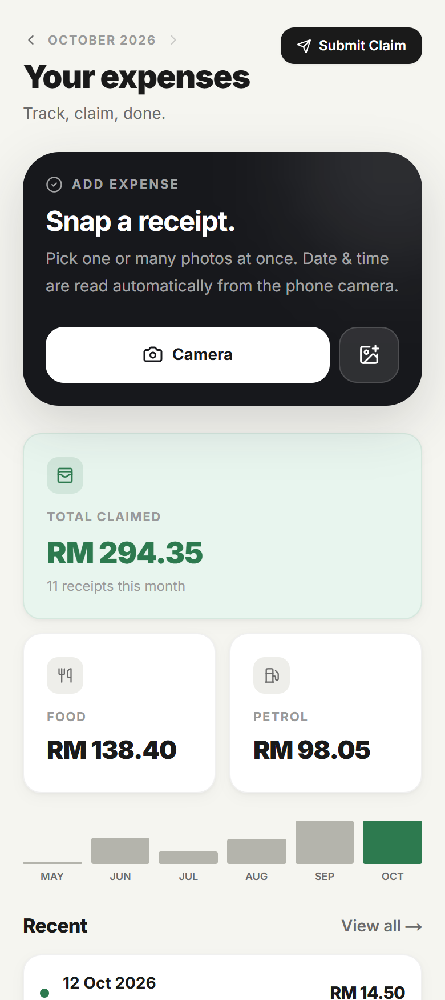
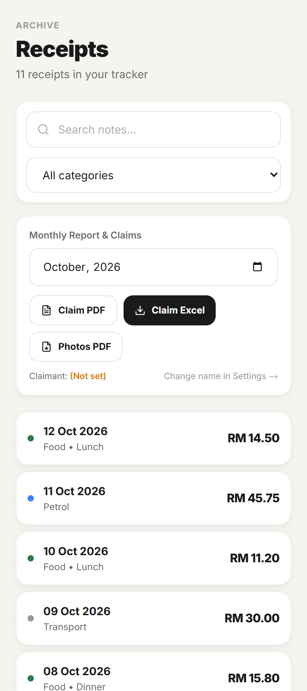
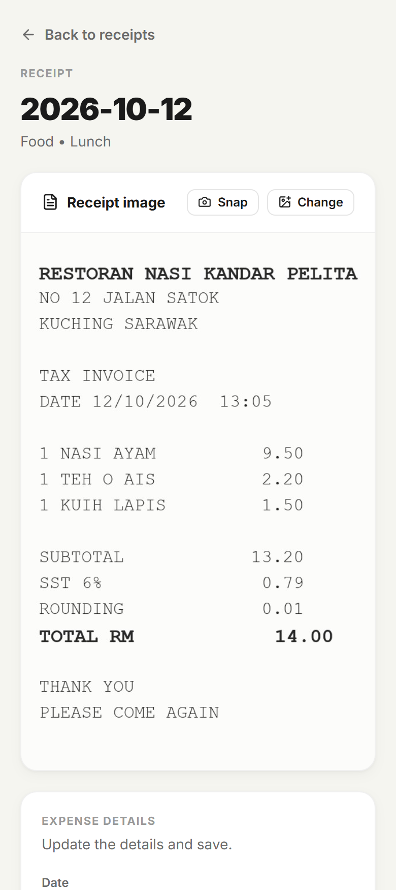

# Receipt Manager

Snap a receipt, check the amount, claim at the end of the month. A small mobile-first web app I built for fun because I got tired of a pile of paper receipts.

> Showcase repo: screenshots and notes only. The source code is private, and everything in the screenshots is fake demo data.

## Why I made it

Claiming expenses meant keeping paper receipts, typing amounts into a spreadsheet at month end, and exporting PDFs by hand. I wanted to do it in a few taps from my phone while the receipt is still in my hand. So I built it, and it turned into a fun side project.

## What it does

- **Snap or upload receipts**, one or many at once. Date and time come from the photo.
- **Reads the total for you.** OCR runs in the browser. It crops to the paper first, so a dark table does not confuse it, then fills in the amount for you to confirm.
- **Monthly dashboard** with total claimed, a Food and Petrol split, and a six month trend. Tap a bar to jump to that month.
- **Receipt archive** with search, category filter and a month picker.
- **Exports** for the month: claim PDF, claim Excel and a PDF of the receipt photos.
- **Claim history**, so the same month does not get submitted twice.
- **Works on bad signal.** Failed uploads wait on the phone and send when the connection is back.
- **Share to the app** from the gallery or WhatsApp (Android).

## Screens

| Dashboard | Receipts | Receipt detail |
| --- | --- | --- |
|  |  |  |

## Built with

- **Frontend:** Next.js, React, TypeScript, Tailwind CSS, tesseract.js (OCR in the browser)
- **Backend:** FastAPI (Python)
- **Data and auth:** Supabase (Postgres, Auth, Storage) with row level security, so everyone only sees their own receipts
- **Hosting:** Vercel for the frontend, Render for the API, GitHub Actions to keep the free server awake

## Things I learned

- OCR on phone photos fails in weird ways. A dark table around the receipt made it return nothing at all. Cropping to the paper fixed it, and I tested the options instead of guessing.
- Reading from the database straight from the browser, and showing the last result while the new one loads, makes the app feel way faster than waiting for a sleepy free-tier server.
- A "submit" button should be safe to press twice. Block duplicates, pick up half-finished work, and say clearly when a login has expired.

Made by **KH4I**
