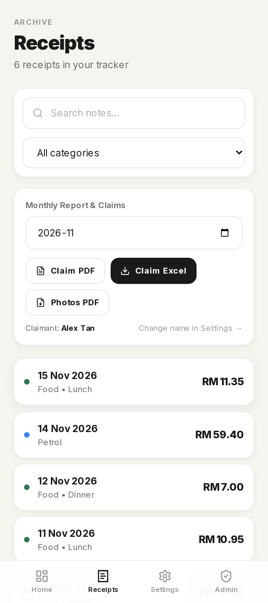
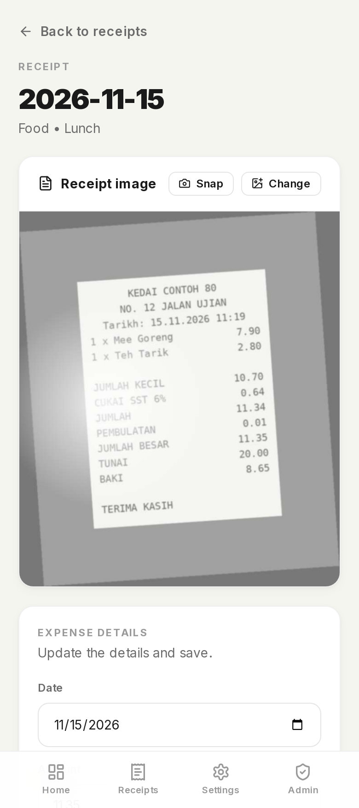

# Receipt Manager

Snap a receipt, check the amount, claim at the end of the month. A small mobile-first web app I built for fun because I got tired of a pile of paper receipts. It started on free hosting, and now it runs on my own server.

> Showcase repo: screenshots and notes only. The source code is private, and everything in the screenshots is fake demo data.

## Why I made it

Claiming expenses meant keeping paper receipts, typing amounts into a spreadsheet at month end, and exporting PDFs by hand. I wanted to do it in a few taps from my phone while the receipt is still in my hand. So I built it, and it turned into a fun side project that I keep improving.

## What it does

- **Snap or upload receipts**, one or many at once, from the camera, the gallery, or the Android share sheet.
- **Reads the receipt for you.** The server runs OCR (software that reads text from images) and suggests the total and the date. If the server cannot read the image, the browser tries on its own. You always confirm before anything is saved.
- **Picks Lunch or Dinner from the time printed on the receipt**, so you do not have to tap it every time.
- **Digital PDF receipts too**, like a bank or e-wallet payment PDF. The PDF is read in your browser and never leaves your phone.
- **Claim rules built in:** a meal claim is capped per meal, and one claim per month goes out.
- **Monthly dashboard** with total claimed, a Food and Petrol split, and a six month trend. Tap a bar to jump to that month.
- **Receipt archive** with search, category filter and a month picker. A warning shows up if the same receipt is added twice, but a lunch and a dinner on the same day are fine.
- **Exports** for the month: claim PDF, claim Excel and a PDF of the receipt photos, grouped by date.
- **Claim history**, so the same month does not get submitted twice, and a one-tap send to the company expense portal.
- **Works on bad signal.** Failed uploads wait on the phone and send when the connection is back.
- **Admin page.** There is no public sign-up. An admin creates accounts, resets passwords and can log someone out or disable them.

## Screens

| Dashboard | Receipts | Receipt detail |
| --- | --- | --- |
|  |  |  |

The screenshots are from an earlier version, so the newer screens look a little different.

## Built with

- **Frontend:** Next.js 16, React, TypeScript, Tailwind CSS
- **Backend:** FastAPI (Python)
- **OCR:** RapidOCR on the server, tesseract.js in the browser as a backup
- **Data:** PostgreSQL, with every query limited to the signed-in user's own receipts
- **Exports:** ReportLab (PDF) and openpyxl (Excel)
- **Hosting:** my own Linux server, with Docker containers and Caddy in front for HTTPS. It moved here from free hosting tiers.
- **Alerts:** Telegram messages for new receipts and server problems

## Things I learned

- OCR on phone photos fails in weird ways. A dark table around the receipt made it return nothing, so I crop to the paper first. Later it read a printed `2:00 PM` as `2:O0 PM` (a letter O instead of a zero) and dropped the time. I tested it on a real screenshot, found the cause, fixed it and added tests.
- A "submit" button should be safe to press twice. Block duplicates, pick up half-finished work, and say clearly when a login has expired.
- Caches need limits. One cache per user, a small size, and one job at a time stopped one busy user from slowing everyone else.
- Running your own server means you own the boring parts: backups, updates, alerts when something breaks, and locking things down. I ran a security review on my own app and fixed what it found.
- Keep the app simple where it counts. It runs one server process on purpose, so its small in-memory limits stay correct.

Made by **KH4I**
